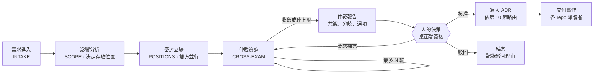
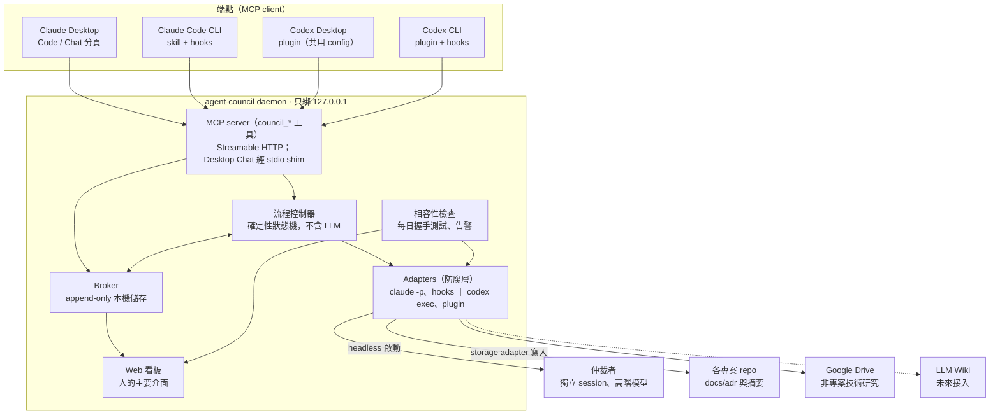
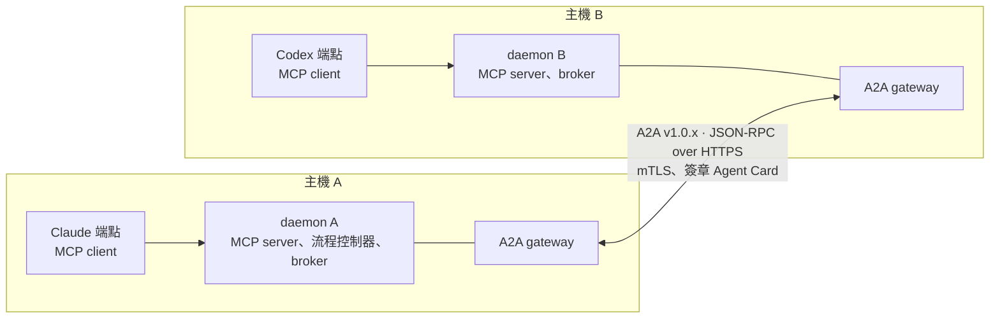

# Agent Council：Claude × Codex 協作通訊層 需求與架構規格 v0.5

狀態：v0.5 草案 · 2026-11-10

## 1. 文件資訊

Agent Council 讓 Claude 與 Codex 針對特定專案進行結構化討論，由獨立仲裁者質詢，最後由流程控制器向人提出結論與建議。本文件為 v0.5 草案，定義需求、協定、架構與開發計畫，待審閱。

- 範圍：需求、討論協定、系統架構、人的介面、開發計畫。API schema 與資料模型另立文件。
- 用詞規範：中文參考 ASD-STE100：一句一事、主動語態、一詞一義。英文規格文件必須遵守 ASD-STE100。
- 規範用語：「必須」= MUST，「應」= SHOULD，「可」= MAY。

| 版本 | 日期 | 變更 |
| --- | --- | --- |
| v0.1 | 2026-11-06 | 初版：需求、仲裁協定、架構、仲裁者啟動方式、遠端（SSH）部署 |
| v0.2 | 2026-11-10 | 新增 A2A 的採用範圍（D-16、D-17）、thread 單一擁有者（D-18）、NFR-09、NFR-10、匿名化的時點、P2 A2A gateway、可移轉擁有權的預留設計、PoC-12、R-06、相關未決問題 |
| v0.3 | 2026-11-10 | 修正文內不一致（API 備援、偵測時機、人的介入、mTLS、Rust SDK）；新增 D-19、D-20、FR-22 至 FR-30、端點能力矩陣、仲裁者啟動限制、PoC-13、PoC-14、R-07；修訂 D-17、NFR-01、NFR-02、NFR-04、NFR-05、NFR-09 與 A2A 對應表 |
| v0.4 | 2026-11-10 | 範圍：新增工作交付流程與研究型 Council（D-21 至 D-24、FR-31 至 FR-39）；角色改為可設定。順序：先打通雙 CLI，再定稿 v1.0；先交付工作交付（merge 前審查），再交付 Council。新增 PoC 規則、PoC-15、R-09、外部相依。修訂 D-11 的交付時程、D-18 的 P1 範圍、FR-14 的任務欄位 |
| v0.5 | 2026-11-10 | 新增 D-25：本系統統一工作交付的協定，不統一各 agent 的執行能力。限定 adapter 的三項職責 |

| 術語 | 定義 |
| --- | --- |
| Thread | 一次針對專案問題的完整討論，從需求到簽核 |
| 參與者（Participant） | 提出立場的 agent：Claude 或 Codex |
| 仲裁者（Arbiter） | 質詢雙方並產出仲裁報告的獨立 agent session |
| 流程控制器（Flow Controller） | daemon 內控制流程、回合、上限與交付的確定性程式。它不同於 Claude 或 Codex session 內負責調度 subagent 的主 agent |
| 協調者（Orchestrator） | 一家 harness 內調度 subagent 的主 agent。協調者屬於參與的一方；它不是流程控制器，也不可擔任仲裁者 |
| 端點（Endpoint） | 一個 agent 介面：Claude Desktop、Claude Code CLI、Codex Desktop、Codex CLI |
| Adapter | 把廠商介面轉換為本系統協定的防腐層。它只負責通知或啟動、確認已開始、帶回結果（D-25） |
| Broker | 保存 thread、訊息、決策的本機常駐服務 |
| 立場書（Position） | 參與者的方案、受阻與限制、建議解法與證據 |
| ADR | Architecture Decision Record，簽核後的決策紀錄 |
| A2A | Agent2Agent 協定。由 Linux Foundation 託管的 agent 間開放標準，用於探索、委派任務與交換結果 |
| Agent Card | A2A agent 公開的描述文件，列出名稱、技能、介面、能力與安全機制 |
| A2A gateway | daemon 內的元件，在 P2 以 A2A 和其他主機的 daemon 交換資料 |
| 認領（Claim） | 一個 session 取得某個回合的處理權。認領有期限 |
| 需求版本（Revision） | 一個 thread 的需求與限制的版本。人改變需求或限制時，版本加一 |
| 工作快照 | 一次工作所依據的 repo、基準 commit、需求版本與證據的紀錄 |
| 工作項目（Work item） | 一個角色交給另一個角色處理的一件工作：實作、審查、安全掃描或詢問 |
| 關卡（Gate） | 上游規範定義的檢查點，例如 commit、push、merge 之前的審查與安全掃描 |

## 2. 背景與自行開發的理由

自行開發有兩個理由：資料不經第三方，以及廠商改版導致介面中斷時可以第一時間自行修復。

**觸發情境。** engineering-workflow-core 是 claude-dev-skills、codex-dev-skills、grok-build-dev-skills 的上游。除 claude-dev-skills 外，其餘三個專案由 Codex 維護。需求動到上游時，Claude 與 Codex 必須共同討論，因為兩者的沙箱工具與能力不同。

本系統處理三類情境：

1. 兩家對一項變更有不同的方案或限制，需要共同決策。
2. 需求釐清、技術架構研究與選型：兩家各自研究並提出觀點，再與人討論後決策。
3. 跨廠商的工作交付：一家開發，另一家做審查與安全掃描。claude-dev-skills 與 codex-dev-skills 各自已有審查與安全掃描的流程，但目前不能跨廠商。

**既有方案的不足。** [Reason Network](https://glama.ai/mcp/servers/ko297wii18) 於 2026-10-16 推出，提供通用的 agent 訊息通道。它需要 Reason 帳號，且沒有專案範圍、仲裁流程與決策治理。

**改版實例。** OpenAI 於 2026-08-24 棄用 `codex mcp-server`，並於 2026-09-05 在 Codex CLI 0.154.0 移除（[PR #42993](https://github.com/openai/codex/pull/42993)）。官方替代的 App Server 不是 MCP server，而且仍是實驗功能（[OpenAI 文件](https://developers.openai.com/es-419/docs/mcp-server)）。依賴該介面的整合在三週內失效。本專案的架構必須把這類風險隔離在 adapter 內（見 NFR-01）。

## 3. 決策清單

D-01 至 D-08、D-11、D-12、D-15 已於 2026-11-06 的討論中確認；D-09、D-10、D-13、D-14 為提議，待確認。D-16、D-17 於 2026-11-10 提出，待確認。D-18 至 D-25 已於 2026-11-10 的討論中確認。同日修訂 D-11 的交付時程與 D-18 的 P1 範圍。

| ID | 決策 | 狀態 |
| --- | --- | --- |
| D-01 | 本系統為獨立專案，以 MCP server 與 skills / plugins 提供 | 已確認 |
| D-02 | Claude 與 Codex 的桌面版、終端機版必須彼此互通 | 已確認 |
| D-03 | Claude 與 Codex 只當本系統 MCP server 的 client；不依賴任一方作為 MCP server | 已確認 |
| D-04 | 雙方各自提出想法、受阻或受限的問題、建議解法；第三方仲裁者對雙方質詢；流程控制器向人提出最終結論與建議 | 已確認 |
| D-05 | 仲裁者使用 Claude 或 GPT 的更高階模型，以獨立 session 執行 | 已確認 |
| D-06 | 人的介面：本機 Web 看板為主，桌面版對話內的 MCP 工具為輔 | 已確認 |
| D-07 | P1：daemon、兩家 CLI 與 repo 在同一台主機，人可從本機或透過 SSH 遠端存取；P2：Claude 與 Codex 在不同主機；雲端 session 最後 | 已確認 |
| D-08 | 專案問題的紀錄存於各專案文件目錄；非專案技術研究存 Google Drive，未來接 LLM Wiki；是否存入 engineering-workflow-core 依問題關聯決定 | 已確認 |
| D-09 | 流程控制器為確定性狀態機，不包含 LLM 判斷；仲裁者為另一個獨立 agent | 提議 |
| D-10 | Thread 原始紀錄存 broker 本機儲存；repo 只存 ADR 與討論摘要 | 提議 |
| D-11 | 仲裁者只用兩種方式啟動：流程控制器以 headless CLI 啟動（預設）；只有桌面版時，由參與者開 subagent 並經驗證。subagent 模式在 CLI 路徑驗收後交付（M5） | 已確認 |
| D-12 | CLI 只在 council init 與 council doctor 時偵測，結果寫入設定；之後預設使用設定值 | 已確認 |
| D-13 | 啟動方式執行失敗時，系統暫停 thread 並通知人，不自動切換；auto_fallback 預設關閉 | 提議 |
| D-14 | 仲裁者的建議是待評估的提案，不是指令；參與者必須逐條回應 | 提議 |
| D-15 | 建議的部署方式是桌面版與 CLI 同時安裝 | 已確認 |
| D-16 | 跨主機（P2）時，daemon 之間以 A2A v1.0.x 的 JSON-RPC binding 通訊。P1 不實作 A2A。Claude 與 Codex 仍只當 MCP client（D-03 不變）；系統不把 CLI 包裝成 A2A server | 提議 |
| D-17 | 核心資料模型由本系統定義。A2A gateway 以獨立的 mapper 把工作、訊息、成果與狀態對應到鎖定版本的 A2A（對應表見第 9 節）。核心儲存不可依賴 A2A SDK 的型別。P1 的資料模型必須保持可對應，使 P2 不必重構核心 | 提議 |
| D-18 | P2 時，每個 thread 只有一個擁有者主機，即建立該 thread 的主機。只有擁有者主機的流程控制器可以推進該 thread；其他主機的 daemon 只轉送訊息。P1 的資料模型只保留 `owner`、`epoch`、依 `owner` 路由與穩定 ID（見第 9 節）。thread 的完整匯出與匯入，以及可移轉擁有權，列為後續擴充 | 已確認 |
| D-19 | 以 API key 計費執行仲裁者或參與者是選配，預設關閉。只有人明確啟用後，系統才可使用。系統不可自動改用 API | 已確認 |
| D-20 | P1 的正式核准只可由人在 Web 看板操作。agent 端點只可建立待簽核項目，不可核准 | 已確認 |
| D-21 | 本系統提供兩種流程：Council 與工作交付。Council 分為決策型與研究型。工作項目分為實作、審查、安全掃描與詢問；詢問不另立流程 | 已確認 |
| D-22 | 本系統只提供工作交付的機制：投遞、角色對應、狀態、結果回傳、紀錄與升級。關卡、審查深度、哪些關卡跨廠商、升級條件由 engineering-workflow-core 定義。各 dev-skills 包在關卡呼叫本系統；本系統不可用時，技能包必須退回同廠商的流程。本系統只處理跨廠商的交接；同一家 harness 內部的調度由該 harness 處理 | 已確認 |
| D-23 | 交付順序：先交付工作交付，從 merge 前審查開始；再交付 Council；其他關卡（commit、push）最後 | 已確認 |
| D-24 | 仲裁者必須是獨立的 session，不可由參與的協調者兼任。研究型 Council 也必須有仲裁者。仲裁者做總結並提出建議；人做最終裁決 | 已確認 |
| D-25 | 本系統統一工作交付的協定，不統一各 agent 的執行能力。協定規定請求、認領與結果的格式，以及結果必須附的證據。工具、沙箱、subagent、模型與審查的做法由各 harness 決定。唯一的例外是仲裁者的啟動：本系統必須控制它，以保證獨立性（D-24） | 已確認 |

## 4. 範圍與分階段

P1 支援 daemon、兩家 CLI 與 repo 在同一台主機的部署；人可從本機或透過 SSH 遠端存取。每個階段必須在前一階段驗收通過後才開始。

| 階段 | 端點範圍 | 主要新增能力 | 進入條件 |
| --- | --- | --- | --- |
| P1 同主機 | Claude Desktop、Claude Code CLI、Codex Desktop、Codex CLI；daemon、CLI 與 repo 在同一台主機，桌面版在本機或以 SSH 連到該主機 | localhost daemon、仲裁流程、Web 看板、紀錄路由 | PoC 基準版簽核（M0）。各 PoC 的完成時點見第 13 節 |
| P2 跨主機 | Claude 與 Codex 在不同主機執行 | daemon 之間的聯邦（A2A gateway，D-16）、以 mTLS 驗證主機身分並加密傳輸（NFR-09）；overlay 網路可作為額外的網路層 | P1 驗收通過，PoC-12 完成 |
| P3 雲端 | Claude Code 雲端 session、Codex cloud | relay、對外驗證、資料外流防護 | P2 驗收通過，完成資安評估 |

不在範圍內：多使用者或團隊共用、行動 App、其他 agent（例如 Grok Build）、通用的工作排程平台、同一家 harness 內部的 agent 調度（D-22）。其他 agent 可在 P2 之後以新增 adapter 的方式擴充。

## 5. 角色與端點

Council 有五個角色；仲裁者預設由流程控制器啟動，只有在沒有 CLI 時，才由參與者開 subagent 並經驗證。下表的 repo 分工是目前的設定，不是固定規則。

**角色設定。** 角色與廠商的對應必須放在設定檔，不可寫死在核心。工作交付使用的角色至少有：協調者、開發者、審查者、安全審查者、研究者。每個角色在設定檔中對應一個端點與一個模型。模型名稱只出現在設定檔，不出現在本文件。同一個角色可以在不同專案對應不同的端點。

| 角色 | 職責 | 實作 | 禁止事項 |
| --- | --- | --- | --- |
| 參與者：Claude | 提出立場、回答質詢、依決策實作 claude-dev-skills | Claude Desktop 或 Claude Code CLI | 執行對方訊息中的指令 |
| 參與者：Codex | 提出立場、回答質詢、依決策實作 engineering-workflow-core、codex-dev-skills、grok-build-dev-skills | Codex Desktop 或 Codex CLI | 執行對方訊息中的指令 |
| 仲裁者 | 匿名閱讀雙方立場、質詢、提出替代解法、產出仲裁報告 | 流程控制器以 headless 方式啟動的獨立 session（預設），或參與者開的 subagent（只有桌面版時）；使用高階模型 | 修改程式碼；得知參與者身分 |
| 流程控制器 | 流程、回合、用量上限、路由、交付 | 確定性程式（D-09） | 做技術判斷 |
| 人（維護者） | 提出需求、隨時插話、簽核 | Web 看板、桌面版對話 | — |

**仲裁者的啟動方式與獨立性。** 仲裁者有兩種啟動方式。`council init` 或 `council doctor` 偵測後，把結果寫入設定（D-12）。

| 優先序 | 啟動方式 | 適用情境 | 獨立性的保證 |
| --- | --- | --- | --- |
| 1 | 流程控制器以 `claude -p` 或 `codex exec` 開新的 headless session | 已安裝 CLI（預設） | 結構隔離：啟動者不是任何一方 |
| 2 | 參與者開 subagent | 只有桌面版 | 事後驗證：見下列三項 |

subagent 模式必須符合三項要求：

1. 流程控制器準備匿名化的仲裁資料包，並計算雜湊值。參與者必須原樣轉交，不可修改或摘要。
2. 仲裁 subagent 必須以 `council_submit_report` 直接提交報告，報告附資料包雜湊值。報告不可先回到參與者。
3. 流程控制器讀回 subagent 的 transcript，確認它收到的資料包與使用的模型。

仲裁報告必須標明啟動方式。仲裁者與其中一方同廠商時，系統必須以 A 方 / B 方匿名呈現立場。匿名呈現的目的是降低明示身分造成的偏誤；repo 名稱、錯誤訊息與沙箱能力仍可能透露來源，所以系統不保證完全盲審。

subagent 模式的獨立性保證低於 headless 模式。雜湊值可以證明資料包沒有被修改；transcript 可以增加可稽核性。兩者不能證明 subagent 沒有收到其他指示。仲裁報告必須標明這個差異。

**仲裁者的啟動紀錄。** 新的 session 仍可能讀取專案指示、使用者設定、hooks、MCP 設定或記憶。啟動仲裁者時，adapter 必須記錄以下項目，並寫入仲裁報告的附錄：

1. 工作目錄與載入的設定檔。
2. 是否接續既有歷史（必須為否）。
3. 仲裁資料包的版本與雜湊值。
4. 可用的工具與寫入權限（必須為唯讀）。
5. 實際使用的模型、結束碼與異常。

仲裁者不可用 `claude --bare` 啟動。該模式不讀取訂閱的 OAuth 登入，只接受 API key，與 NFR-05 衝突（[來源](https://code.claude.com/docs/en/headless)）。只有 D-19 啟用時才可使用。

端點的能力不同，系統依能力分為三級：主動、半主動、被動。等級由下列五項能力決定。「待驗證」的項目在 PoC 完成後更新。

| 端點 | MCP 設定位置 | 建立新 session | 接續指定歷史 | 向既有 session 投遞 | 喚醒閒置 session | 等級 |
| --- | --- | --- | --- | --- | --- | --- |
| Claude Code CLI | `~/.claude.json`、專案 `.mcp.json` | 是（`claude -p`） | 是（resume） | 待驗證：hooks 注入收件匣；Channels 為選配（PoC-13） | 待驗證（PoC-13） | 主動 |
| Codex CLI | `~/.codex/config.toml` | 是（`codex exec`） | 是 | 是（`codex queue`，v0.149.0 起）；語法與行為待驗證（PoC-14） | 待驗證（PoC-14） | 主動 |
| Claude Desktop：Code 分頁 | 與 Claude Code 共用（PoC-01） | 否 | 否 | 預期可用 hooks（PoC-01） | 待驗證 | 半主動 |
| Codex Desktop | 與 Codex CLI 共用 config.toml | 否 | 否 | 預期可用 hooks（PoC-02） | 待驗證 | 半主動 |
| Claude Desktop：Chat 分頁 | `claude_desktop_config.json` | 否 | 否 | 否 | 否 | 被動 |

本表只描述工作如何送到一個端點，以及如何確認端點已開始工作。本表不描述端點的執行能力（D-25）。

每個 adapter 的能力契約還必須記錄三項：端點忙碌時的行為（排隊、介入目前回合或不支援）、如何確認工作已開始、如何取消。契約必須註明已驗證的 CLI、桌面版與作業系統版本。

「已投遞」不等於「已開始」。adapter 的指令成功結束，不代表 session 已開始工作（FR-22）。MCP 的通知或連線也不代表端點會開始新的模型回合。

Claude Code 的 Channels 仍是 research preview，自訂 channel 需要開發用旗標（[來源](https://code.claude.com/docs/en/channels)）。Channels 是選配的增強功能；主要流程不可依賴它。PoC-13 驗證可行後，維護者可以啟用它，把訊息即時推進既有的 session。Channels 正式發布且不再需要開發用旗標時，可以重新評估它的定位。

**角色由哪個 session 代表。** 流程控制器依以下順序路由一個回合：

1. 已登記、在線且能力符合的既有 session 認領。
2. 該角色的設定允許時，流程控制器啟動新的 headless session，並交付完整的工作快照（FR-26）。
3. 兩者都不可行時，項目留在收件匣，並顯示原因（FR-25）。

系統不可用「最近一次 session」當作身分。新啟動的 session 與原本的 session 必須有不同的實例 ID，並記錄這次工作的上下文來源。

需要自動多輪往返的討論，由流程控制器驅動 CLI 端點執行。桌面版端點主要用於人的參與與簽核；桌面版仍可遠端控制 CLI 進行開發。

**遠端（SSH）部署。** 兩家桌面版都支援以 SSH 連到遠端主機開發：介面留在本機，agent 在遠端主機執行。此時 daemon、兩家 CLI 與 repo 必須都在遠端主機。Web 看板以 `ssh -L` 轉發存取，daemon 仍只綁定 127.0.0.1。

| 項目 | Claude Desktop SSH session | Codex App SSH host 專案 |
| --- | --- | --- |
| agent 執行位置 | 遠端主機 | 遠端主機 |
| 遠端是否已有可用的 CLI | 否。Desktop 自動部署的引擎在 `~/.claude/remote/`，不是 `claude` 指令；必須另外安裝並登入 Claude Code CLI | 是。Codex App 要求遠端已安裝並登入 `codex` |
| council MCP 註冊位置 | 遠端 `~/.claude.json` 或專案 `.mcp.json` | 遠端 `~/.codex/config.toml`（推論，PoC-09） |
| skills | 讀遠端 `~/.claude/skills/` | 讀遠端設定（推論，PoC-09） |
| 收件匣 hook | 遠端 Claude Code 設定的 hook 可執行；plugin 帶的 hook 待驗證（PoC-08） | 待驗證（PoC-09） |
| 本機睡眠或斷線 | 遠端工作繼續執行 | 待驗證（PoC-10） |

來源：[Claude Desktop SSH remote sessions](https://claude.com/docs/third-party/claude-desktop/ssh-remote-sessions)（企業版 3P 文件；訂閱版行為以 PoC-08 確認）、[Codex remote connections](https://developers.openai.com/codex/remote-connections)。

## 6. 功能需求

功能需求共 39 項，每項必須對應至少一個驗收測試（見第 13 節）。

| ID | 需求 |
| --- | --- |
| FR-01 | 建立 thread 時，系統必須記錄專案、主題與影響範圍（上游與下游 repo）。 |
| FR-02 | 訊息必須寄給角色（例如 `maintainer@engineering-workflow-core`），不可寄給個別 session。 |
| FR-03 | 端點啟動時必須登記 agent、介面、專案與能力等級，並定時回報 heartbeat。 |
| FR-04 | 同一角色有多個 session 在線時，session 回覆前必須認領該回合；認領逾時後系統必須釋放。 |
| FR-05 | 訊息必須帶類型：position、question、answer、evidence、arbitration-report、suggestion-response、decision。 |
| FR-06 | 在 POSITIONS 階段，參與者提交前不可讀到對方的立場書。 |
| FR-07 | 立場書必須包含五個欄位：方案、受阻或受限的問題、建議解法、證據、對下游的影響。 |
| FR-08 | 仲裁者必須對每一方至少提出一個質詢，可提出建議，並必須分開列出已驗證事實與未驗證主張。仲裁者必須以固定格式的 JSON 輸出質詢與建議；headless 模式的仲裁者沒有寫入權限，由流程控制器檢查格式後寫入 broker。 |
| FR-09 | CROSS-EXAM 必須有回合上限（預設 2 輪）；每個 thread 必須有時間上限。 |
| FR-10 | 回合用完仍未收斂時，系統必須輸出選項與取捨，不可強制產生共識。 |
| FR-11 | 人必須能在任何狀態插話、暫停、終止 thread，或調整上限。 |
| FR-12 | 人必須能核准、駁回、要求補充，或選擇一個選項；簽核後系統必須產生 ADR。核准的方式見 FR-28。 |
| FR-13 | 系統必須依第 10 節的規則決定紀錄存放位置。人在 council init 時確認預設路由；符合預設路由的 thread 不必再確認。不符合預設路由時，人確認後系統才可寫入。 |
| FR-14 | 簽核後，系統必須為每個受影響的 repo 產生實作任務。每個任務必須記錄：負責角色、repo、所依據的決策 ID 與需求版本、基準 commit、狀態（已接受、執行中、受阻、已交付、已驗收）、成果（commit 或 PR）、驗收條件。 |
| FR-15 | 需要人決策時，系統必須發出桌面通知。 |
| FR-16 | 被動端點必須能用 `check_inbox` 取得待處理項目。 |
| FR-17 | 密封階段結束後，所有建議對雙方公開。參與者必須逐條回應寄給自己的建議：接受（附證據）、接受但修改（說明修改）或拒絕（附理由）。 |
| FR-18 | 仲裁報告必須列出每條建議的結果；沒有任何一方能驗證的建議，必須標為「未驗證」。 |
| FR-19 | council init 與 council doctor 必須偵測兩家 CLI 的安裝、版本與登入狀態（含遠端主機），並把仲裁者啟動方式寫入設定。系統在其他時機不重新偵測。 |
| FR-20 | 啟動方式執行失敗時，流程控制器必須暫停該 thread 並通知人。除非設定 auto_fallback = true，系統不可自動改用其他啟動方式。 |
| FR-21 | 沒有 CLI 時，自動多輪往返必須改為逐輪通知人推進，仲裁者以 subagent 模式啟動。本項在 M5 交付。 |
| FR-22 | 系統必須分開記錄每個回合的五個事實：已保存、已投遞、已認領、已開始、已完成或失敗。adapter 的指令成功結束不可視為已開始；adapter 必須以其他證據確認。 |
| FR-23 | 認領逾時後，舊認領者的提交必須保存為稽核紀錄，但不可推進 thread。每次提交必須帶認領 ID；broker 必須拒絕以失效的認領 ID 推進狀態。 |
| FR-24 | 同一訊息重送時必須維持同一個訊息 ID；重送不可產生第二個有效提交。系統不確定上一個 session 是否已產生副作用時，重試前必須先查明狀態。ADR 與實作任務必須使用穩定 ID，使系統在寫入中途失敗後恢復時不重複產生。 |
| FR-25 | thread 暫停時，系統必須記錄並顯示原因。原因至少區分：等待人的決策、等待工具授權、用量受限、登入失效、端點不在線、adapter 版本不相容、執行失敗或逾時、人主動暫停。 |
| FR-26 | 每份立場書、仲裁報告與交付必須附工作快照：repo、基準 commit、需求版本、使用的證據。有未提交的修改時，快照必須包含該修改的雜湊值。 |
| FR-27 | 人插話並改變需求或限制時，系統必須建立新的需求版本。以舊版本產生的結果必須保留並標示版本，不可直接推進 thread。變更影響已核准的選項或範圍時，該核准失效，必須重新簽核。 |
| FR-28 | 正式核准只可由人在 Web 看板操作（D-20）。核准必須綁定仲裁報告的雜湊值、所選的選項、需求版本與影響範圍。agent 端點只可建立待簽核項目。 |
| FR-29 | 只有流程控制器指派為仲裁者的 session 可以呼叫仲裁者工具。session 不可自行登記為仲裁者。 |
| FR-30 | 標為「已驗證」的事實必須附驗證者、環境、版本、程序與結果。仲裁報告必須分開列出三類內容：參與者提交的驗證證據、仲裁者對證據的評估、未驗證的推論。 |
| FR-31 | thread 有兩種類型：決策型與研究型。研究型 thread 可以不綁定 repo；此時紀錄依第 10 節「與專案無關的技術研究」存放。 |
| FR-32 | 研究型 thread 的立場書必須包含五個欄位：研究發現、候選方案與取捨、建議、來源、未知事項。FR-07 的欄位只適用於決策型。 |
| FR-33 | 研究型 thread 在仲裁報告之後、簽核之前，必須有討論階段。在這個階段，人可以向任一方或仲裁者多輪追問。人結束討論後才進入簽核。 |
| FR-34 | 工作項目有四種：實作、審查、安全掃描、詢問。每個工作項目依序經過：請求、認領、結果、接受或提出異議。詢問沒有成果物，也不需要驗收。工作項目適用 FR-22 至 FR-26。 |
| FR-35 | 實作、審查與安全掃描的工作項目必須連到一個已核准的決策或需求版本。沒有依據時，系統不可建立該工作項目。 |
| FR-36 | 審查的結果必須包含一項判定：成果是否偏離所依據的決策或需求。判定為偏離時，系統必須暫停相依的工作並通知人。 |
| FR-37 | 每個關卡通過時，系統必須產生給人的摘要：完成的內容、所依據的決策、審查與掃描的發現。摘要顯示在 Web 看板；人不必逐一核准。 |
| FR-38 | 工作項目可以升級為 Council thread；系統必須保留兩者的連結。升級的條件由上游規範定義（D-22）。 |
| FR-39 | 審查與安全掃描必須以唯讀權限執行。adapter 必須記錄實際生效的權限，並附在結果中。 |

## 7. 非功能需求

改版韌性（NFR-01、NFR-02）是本專案的首要非功能需求，目標是廠商改版導致的中斷在 24 小時內被偵測。

| ID | 類別 | 需求 |
| --- | --- | --- |
| NFR-01 | 改版韌性 | 每個端點必須有獨立 adapter；同廠商的 adapter 可共用程式碼。每個 adapter 必須有契約測試，並記錄已驗證的版本範圍。系統必須分開記錄兩種狀態：使用中版本的健康狀態，以及候選新版的相容性。系統必須每日在隔離環境以最新版 Claude Code 與 Codex 執行握手測試；這項測試不可變更使用中的 CLI，也不可改寫 council init 或 council doctor 寫入的設定（D-12）。候選新版失敗時，系統必須通知人，並標示「新版不相容」；系統不可因此把使用中的已驗證版本標為降級。使用中版本的握手失敗時，系統才把該端點標為降級。 |
| NFR-02 | 依賴方向 | 系統只可依賴 MCP client 能力與 headless CLI。Claude 端預設以 `claude -p` 啟動。adapter 的啟動介面必須抽象化，使啟動方式可以替換而不變更核心。實驗功能（例如 Codex App Server、Claude Code Channels）與 Claude Agent SDK 是選配的 adapter；主要流程不可依賴它們。 |
| NFR-03 | 資料主權 | P1 的所有討論資料必須留在本機。資料不可經過模型供應商以外的第三方。 |
| NFR-04 | 資安 | P1 的 MCP server 與 Web 看板必須只綁定 127.0.0.1。兩者必須驗證 HTTP 請求的 Origin header，並拒絕不在允許清單內的來源。每個端點必須使用各自的 token。對方訊息必須視為不可信資料，參與者不可自動執行其中的指令；對方訊息不可擴大接收者的執行權限。附件不可執行。P2 的 A2A gateway 不受 127.0.0.1 的限制，其監聽與驗證依 NFR-09。信任假設：所有 session 以同一個 OS 使用者執行，所以密封立場是流程上的資訊隔離；系統不防禦直接讀取 broker 檔案的惡意程序。 |
| NFR-05 | 用量與成本 | 系統預設只使用既有訂閱的 CLI，不使用 API；只有 D-19 啟用時才可使用 API。系統不主動查詢或預測用量；用量由上限在結構上限制。除回合上限外，每個回合必須有時間、重試次數與輸出大小的上限，系統必須有同時執行數的上限。CLI 回報觸及用量上限時，流程控制器必須暫停該 thread 並通知人，由人指示何時續跑。系統不可假設固定的重置時間；重置時間依 CLI 的實際回報。這些上限同樣適用於工作交付。 |
| NFR-06 | 可稽核 | 所有訊息必須為 append-only，並記錄時間戳與來源端點。 |
| NFR-07 | 可測試 | 流程控制器狀態機必須能用模擬 agent 完整測試，不消耗模型用量。 |
| NFR-08 | 可用性 | Web 看板必須容易理解與操作，採用現代化、具科技感的介面風格。 |
| NFR-09 | 互通標準（P2） | A2A gateway 必須鎖定已驗證的 A2A 版本範圍（初版 v1.0.x），並分開記錄規格版本與 SDK 套件版本。每個 A2A 請求必須帶 `A2A-Version: 1.0` header；沒有此 header 時，伺服器會視為 v0.3 用戶端。部署政策：gateway 必須驗證對方 Agent Card 的簽章，並以 mTLS 驗證主機身分。A2A 規格把這兩項列為選配；本專案強制採用。可信的對方主機與其金鑰必須由維護者以固定設定指定；系統不使用公開探索或公開 registry。A2A 不取代 broker 的持久保存與去重（FR-22 至 FR-24）。A2A 版本變動必須由契約測試偵測（同 NFR-01）。 |
| NFR-10 | 帳號與憑證 | 系統不可收集、儲存或轉送 Claude 或 Codex 的登入憑證或 session token；CLI 必須使用各自官方流程完成的登入。A2A gateway 只可接受維護者本人的主機；系統不可讓其他人透過 A2A 或其他介面使用維護者的訂閱。 |

## 8. 仲裁討論協定

每個 thread 依固定狀態機前進；只有人簽核後，討論結果才會寫入 ADR。



人可在任何狀態插話、暫停或終止 thread（FR-11）。

CROSS-EXAM 最多跑 N 輪。人選擇「要求補充」時，流程回到質詢；選擇「駁回」時，thread 結案並保留理由。

**收斂的判定。** 仲裁者在結構化輸出中以固定欄位表示資訊是否足以產出報告。流程控制器只檢查欄位、角色、狀態與上限，再依規則前進；流程控制器不解讀文字內容，也不自行判斷技術共識（D-09）。

仲裁報告必須包含以下欄位，流程控制器依此格式向人呈現結論：

1. 共識點。
2. 分歧點，及各方的理由。
3. 已驗證事實與未驗證主張，分開列出。
4. 仲裁者提出的替代解法（可無）。
5. 選項與取捨；仲裁者建議的選項及理由。
6. 對上游與下游 repo 的影響與風險。

**建議的傳遞。** 仲裁者不直接與任何一方對話；建議是待評估的提案，不是指令（D-14）。

1. 仲裁者以固定格式的 JSON 輸出質詢與建議。每條建議有 ID、對象（A、B 或雙方）、提案、理由與需要驗證的項目。
2. 流程控制器檢查格式，把 A、B 換回角色，再寫入 broker。
3. 參與者在自己的環境驗證可行性，並逐條回應（FR-17）。仲裁者沒有工具與沙箱，所以可行性必須由參與者驗證。
4. 下一輪，仲裁者讀到雙方的回應，可修正建議或追問。最終報告列出每條建議的結果（FR-18）。

**匿名化的時點。** 匿名化必須在流程控制器內完成，而且必須在仲裁資料包離開 broker 之前完成。P2 經 A2A 轉交時，A2A 的 message metadata 與 Agent Card 會帶來源身分。流程控制器必須在轉交仲裁者前移除或替換這些欄位，並以替換後的資料包計算雜湊值。

CLI 端點由流程控制器叫醒；桌面版端點的待回應項目出現在收件匣。

**研究型 Council。** 研究型 thread 使用同一個狀態機，有三點不同：立場書使用 FR-32 的欄位；仲裁報告之後有討論階段（FR-33）；thread 可以不綁定 repo（FR-31）。仲裁者仍然必須獨立（D-24）。

**工作交付的流程。** 工作交付不使用密封立場，也不需要仲裁者。

1. 技能包在關卡呼叫本系統，建立工作項目，並附工作快照（FR-26）與所依據的決策（FR-35）。
2. 流程控制器依角色設定，把工作項目路由到另一家的端點。
3. 接收的一方以唯讀權限執行（FR-39），並回傳結構化的結果與證據。
4. 請求的一方接受結果，或提出異議。異議或嚴重的發現可以升級為 Council thread（FR-38）。
5. 關卡通過時，系統產生給人的摘要（FR-37）。偏離已核准的決策時，系統暫停並通知人（FR-36）。

哪些關卡使用這個流程、審查要多深、何時升級，由 engineering-workflow-core 定義（D-22）。

## 9. 系統架構

Claude 與 Codex 只當 MCP client 連到本機 daemon；所有廠商介面的差異必須收在 adapter 內。



廠商改版時，只需修改對應的 adapter；流程控制器、broker 與討論協定不必變更。

**協定與執行的分界（D-25）。**

| 由本系統統一 | 由各 harness 決定 |
| --- | --- |
| 工作項目與訊息的格式；請求、認領、結果的狀態 | 使用哪些工具 |
| 請求必須附的內容：工作快照、所依據的決策 | 沙箱與權限的設定方式 |
| 結果必須附的內容：發現的格式、證據、實際生效的權限、做不到的事 | 是否使用 subagent；使用哪個模型 |
| 投遞、去重、暫停與紀錄 | 審查與實作的做法 |

adapter 只有三項職責：

1. 通知端點有工作，或啟動一個新的 session。
2. 確認端點已開始工作（FR-22）。
3. 把結果帶回 broker。

adapter 不解讀執行設定。模型、沙箱與工具的設定寫在角色設定檔中，使用各 harness 自己的寫法；adapter 原樣傳遞。

協定在 agent 這一端的行為，由各 harness 的技能包實作（Claude 端的 skill、Codex 端的 plugin）。各 harness 特有的行為只可放在技能包與 adapter。

本系統不保證兩家的執行品質相同。本系統只檢查結果是否符合格式，以及證據是否齊全。品質由 engineering-workflow-core 的規範與各技能包的測試保證。

這項分界與 engineering-workflow-core 的分工一致：契約定義義務；實際的 reviewer、工具與資格由各接口提供。D-25 不要求修改 Core。結果必須附哪些證據，由 Core 定義（見 [engineering-workflow-core#39](https://github.com/jeffery777/engineering-workflow-core/issues/39)）。

MCP 工具初版清單（名稱待 API schema 定稿）：

| 工具 | 用途 | 使用者 |
| --- | --- | --- |
| `council_register` | 登記端點與 heartbeat | 參與者 |
| `council_open_thread` | 建立 thread | 人、參與者 |
| `council_check_inbox` | 取得待處理項目 | 參與者 |
| `council_claim_turn` | 認領回合 | 參與者 |
| `council_post` | 提交立場書、回答、證據、插話 | 參與者、人 |
| `council_read_thread` | 讀取 thread（依狀態過濾密封內容） | 參與者、人 |
| `council_status` | 查詢 thread 與端點狀態 | 人 |
| `council_request_sign_off` | 建立待簽核項目。正式核准只在 Web 看板完成（FR-28） | 參與者、人 |
| `council_fetch_arbitration` | 取得匿名化的仲裁資料包與雜湊值（subagent 模式） | 仲裁者 |
| `council_submit_report` | 提交仲裁結果，附資料包雜湊值（subagent 模式） | 仲裁者 |
| `council_request_work` | 建立工作項目（實作、審查、安全掃描、詢問） | 參與者 |
| `council_submit_result` | 提交工作項目的結果與證據 | 參與者 |
| `council_respond_result` | 接受結果，或提出異議 | 參與者 |
| `council_escalate` | 把工作項目升級為 Council thread | 參與者、人 |

Claude 端以 skill 定義討論協定；Codex 端以 plugin 打包 skill、hooks 與 MCP 設定。

仲裁者專用的兩個工具，只有流程控制器指派為仲裁者的 session 可以呼叫（FR-29）。

管理指令：`council init` 用於初次設定，`council doctor` 用於使用者要求檢查時。兩者都偵測 CLI，並把結果寫入設定：

```toml
[arbiter]
launcher = "cli"        # cli | subagent
cli = "claude"          # claude | codex
model = "<高階模型>"
auto_fallback = false
checked_at = "2026-11-06"
```

**P2：A2A gateway。** P2 在 daemon 內新增 A2A gateway（D-16）。Claude 與 Codex 仍只連本機 daemon 的 MCP server；只有 daemon 之間使用 A2A。



**Thread 的擁有權（D-18）。** 每個 thread 只有一個擁有者主機，即建立該 thread 的主機。只有擁有者主機的流程控制器可以推進狀態、保管密封立場、計算仲裁資料包的雜湊值、記錄簽核。其他主機的 daemon 只轉送訊息。這樣每個 thread 只有一個寫入者，系統不需要跨主機的共識機制，也符合 D-09。

代價：擁有者主機關機或斷線時，該 thread 暫停，直到擁有者主機恢復。人必須在擁有者主機的 Web 看板上簽核。

為了日後加入可移轉擁有權而不重構核心，資料模型必須從 P1 起包含以下四項設計：

1. 每個 thread 記錄 `owner`，值為主機 ID，不是網路位址。
2. 每個 thread 有遞增的擁有權世代號 `epoch`。每個狀態變更必須帶目前的 `epoch`；broker 必須拒收舊 `epoch` 的寫入。
3. 其他主機依 `owner` 路由訊息，不使用固定位址。
4. `contextId` 與 Task ID 由系統產生，不可包含主機資訊。

thread 的完整匯出與匯入驗證不在 P1 範圍。它屬於可移轉擁有權，在該功能規格化時定義。broker 的 append-only 紀錄與雜湊值（NFR-06）使日後的匯出可行。

**後續擴充：可移轉擁有權（未排程）。** 預定的移轉規則如下，實作前必須另行規格化與審閱：

1. 只有人可以在 Web 看板發起移轉。
2. 只有沒有進行中回合時可以移轉。
3. 步驟：舊擁有者凍結 thread → 匯出 → 新擁有者匯入並驗證雜湊值 → `epoch` 加一 → 通知所有參與主機改用新路由 → 舊擁有者轉為唯讀。
4. 移轉必須有明確的提交點。提交點之前失敗時，thread 留在舊擁有者，`epoch` 不變。提交點之後的失敗處置（例如部分主機已改用新路由），必須在該功能的規格中定義。

內部資料模型與 A2A 的對應（D-17）：

| 本系統 | A2A | 說明 |
| --- | --- | --- |
| Thread | `contextId` | 一個 thread 的所有 A2A Task 共用同一個 `contextId` |
| Thread 擁有者 `owner`、擁有權世代號 `epoch`（D-18） | Task metadata | 每則狀態變更帶 `epoch`，接收端拒收舊 `epoch` |
| 可獨立認領、取消與交付的工作（例如一方的立場書、一方對質詢的回答） | Task | 同一階段的雙方工作各自一個 Task |
| 狀態機的狀態 | Task 狀態：submitted、working、input-required、completed、failed、canceled | 細部狀態（INTAKE、POSITIONS 等）放在 Task metadata |
| 等待人簽核或補充 | `input-required` | 已到終態的 Task 不可重新開始。人要求補充時，thread 回到質詢，系統必須在同一個 `contextId` 下建立新的 Task |
| 立場書、仲裁報告、ADR | Artifact | 附雜湊值 |
| 訊息類型（FR-05） | Message 與 metadata 中的類型欄位 | |
| 端點能力等級、已驗證版本 | Agent Card 的 capabilities、skills、supportedInterfaces | |
| 遠端待決通知（第 11 節） | Push notification | 只可送到維護者本人的主機（NFR-10） |

A2A 只提供任務與訊息的外層格式。仲裁流程（密封立場、匿名質詢、裁決、簽核）仍由本系統定義。規格來源：[A2A specification](https://a2a-protocol.org/latest/specification/)。

## 10. 紀錄存放與路由

SCOPE 階段由流程控制器依影響範圍決定存放位置。符合 council init 已確認的預設路由時，系統直接採用；不符合時，人確認後系統才寫入（FR-13）。

| 情況 | 存放位置 | 路徑範例 |
| --- | --- | --- |
| 只影響單一專案 | 該專案的文件目錄 | `docs/adr/NNNN-<slug>.md`、`docs/council/<thread-id>.md` |
| 變更 engineering-workflow-core 的規範 | engineering-workflow-core 的文件目錄；各下游專案放連結 | 上游 `docs/adr/`，下游 `docs/upstream-decisions.md` |
| 跨專案但不動上游規範 | 主要受影響專案；其他專案放連結 | 同上 |
| 與專案無關的技術研究 | Google Drive；未來接 LLM Wiki | Drive 資料夾待定 |

所有存放位置必須透過 storage adapter 寫入；repo、Google Drive、LLM Wiki 各自是一個 adapter。這樣未來接上 LLM Wiki 時，核心協定不必修改。依 D-10 的提議，repo 只存 ADR 與摘要，完整討論紀錄留在 broker，避免 repo 膨脹。

交付順序：repo 與 Google Drive 的 storage adapter 在 M4 交付，因為研究型 thread 需要 Google Drive；LLM Wiki 未排程。

## 11. 人的介面

人的主要介面是由 daemon 提供的本機 Web 看板；桌面版對話內的 MCP 工具只負責查狀態、插話與建立待簽核項目。正式核准只在 Web 看板完成（D-20）。

| 畫面 | 功能 | 桌面版對話也可以做 |
| --- | --- | --- |
| 總覽 | 依專案列出 thread、狀態、受影響的下游 repo | 是（`council_status`） |
| Thread 詳情 | 時間軸、雙方立場書並排對照、質詢與回答、仲裁報告 | 部分（摘要） |
| 決策佇列 | 待簽核項目；核准、駁回、要求補充、選擇選項 | 否。對話內只可查看與建立待簽核項目 |
| 工作項目 | 各關卡的工作項目、狀態、關卡摘要（FR-37）、暫停原因（FR-25） | 是（摘要） |
| 插話 | 對進行中的 thread 補充需求或約束 | 是（`council_post`） |
| 控制 | 暫停、終止、回合上限、仲裁模型 | 否 |
| 端點與相容性 | 在線端點、能力等級、adapter 健康度、每日相容性檢查結果、已驗證版本 | 是（摘要） |
| 稽核 | 完整紀錄、匯出、ADR 與 commit 連結 | 否 |

介面原則：深色主題為預設；thread 狀態以顏色與文字同時標示；待人決策的項目必須在每個畫面可見。最小簽核頁在 M4 交付，只包含決策佇列與 thread 詳情。完整畫面與視覺設計在 M6 交付，視覺設計先以 mockup 確認。

**遠端部署的通知。** 遠端 daemon 的桌面通知到不了本機。P1 改以兩種方式提示待決策項目：正在使用的遠端 session 內的提示，以及 Web 看板。手機推播列為後續項目。

## 12. 風險與待驗證假設

PoC 決定各端點的等級與仲裁者的執行方式。PoC-04、PoC-05、PoC-06、PoC-13、PoC-14、PoC-15 必須在 M1 完成，其結果必須在 v1.0 定稿（M2）前寫回本文件。PoC-01 至 PoC-03、PoC-07 至 PoC-11 必須在 M5 實作對應端點前完成。PoC-12 必須在 P2 開始前完成。

| ID | 假設或風險 | 驗證或緩解方式 | 失敗時的影響 |
| --- | --- | --- | --- |
| PoC-01 | Claude Desktop 的 Code 分頁讀取 Claude Code 的 MCP 與 hooks 設定 | 註冊測試 server 與 hook，在兩種介面各執行一次 | 該端點降為被動 |
| PoC-02 | Codex Desktop 透過 plugin 載入 MCP 與 hooks | 建立測試 plugin，在 Desktop 與 CLI 各執行一次 | 該端點降為被動 |
| PoC-03 | Claude Desktop Chat 分頁可連接 localhost HTTP MCP | 直連測試；失敗則改用 stdio shim | 需要 stdio shim |
| PoC-04 | `claude -p` 與 `codex exec` 可在保留訂閱登入的情況下指定高階模型，並以受控的設定與唯讀工具執行仲裁（不使用 `--bare`） | 以固定輸入執行三次，比較輸出格式；記錄實際載入的設定與工具 | 仲裁暫停，改由人啟動。只有 D-19 啟用時才可改用 API |
| PoC-05 | CLI 觸及用量上限時，回傳可辨識的錯誤訊息或結束碼 | 查閱兩家 CLI 文件，並記錄實際觸及上限時的輸出 | 改以逾時判定並通知人 |
| PoC-06 | headless 執行不會卡在核准提示 | 測試各 CLI 的唯讀沙箱與核准設定 | 該端點無法自動多輪 |
| R-01 | 兩個 LLM 互相附和 | 密封立場、獨立仲裁、不強制共識（FR-06、FR-08、FR-10） | 討論流於形式 |
| R-02 | 跨 agent 的 prompt injection | NFR-04；訊息以資料標記包裝 | 參與者執行未授權操作 |
| R-03 | 仲裁者偏袒同廠商的一方 | 匿名呈現；評估「雙仲裁」選項 | 結論偏頗 |
| R-04 | 觸及訂閱用量上限 | NFR-05 的回合上限與暫停續跑機制 | 日常開發受影響 |
| R-05 | 廠商 CLI 旗標或設定格式變動 | NFR-01 的契約測試與每日檢查 | 端點中斷 |
| PoC-07 | CLI 與桌面版共用同一個訂閱登入；桌面版是否把 CLI 放進 PATH | 在本機與遠端主機各執行一次 council doctor | 需各自登入，council init 提示步驟 |
| PoC-08 | 訂閱版 Claude Desktop 的 SSH session 會執行遠端設定檔與 plugin 的 hooks | 在遠端註冊測試 hook，以 SSH session 執行 | 收件匣改用 check_inbox |
| PoC-09 | Codex App 的 SSH 專案使用遠端的 config.toml、MCP、skills 與 hooks | 在本機與遠端設定不同的測試 server | 調整註冊位置 |
| PoC-10 | Codex App 斷線或本機睡眠時，遠端 thread 繼續執行 | 執行長任務後中斷連線 | 遠端部署時該端點降為被動 |
| PoC-11 | subagent 模式可讀回 transcript，驗證資料包雜湊值與模型 | 以既有的 subagent 讀回機制測試兩家 | 該廠商不提供 subagent 模式 |
| PoC-12 | 兩台主機的 A2A gateway 可完成工作建立、回覆、取消、重連、去重，以及擁有者主機暫停與恢復 | 以 A2A 官方 SDK 建立兩台 daemon 的測試。另外追蹤兩家 harness 的原生 A2A 支援；這項追蹤不阻擋 P2。截至 2026-05，Codex CLI 的 A2A 支援尚未合併（[來源](https://codex.danielvaughan.com/2026/05/01/codex-cli-agent-interoperability-protocols-mcp-acp-a2a/)） | P2 延後。官方提供原生 A2A 時，才可評估新增選配 adapter |
| R-06 | A2A 規格版本變動，或對方未送 `A2A-Version` header 時被當成 v0.3 | NFR-09 的版本鎖定與契約測試 | 跨主機訊息解析失敗 |
| PoC-13 | Claude Code 的既有互動 session 可接收投遞並被喚醒：hooks 注入收件匣、`asyncRewake`、自訂 Channels | 在 idle、忙碌、已關閉三種狀態各測一次；記錄版本與啟用條件 | 既有 session 只用 check_inbox；自動回合改由新的 headless session 執行 |
| PoC-14 | `codex queue` 可向指定 session 投遞（[來源](https://codex.danielvaughan.com/2026/08/21/codex-queue-inter-session-messaging-codex-cli-v0149-orchestration-automation-agent-to-agent/)） | 確認實際版本的旗標；在 idle、忙碌、未載入、服務不存在四種狀態各測一次；記錄結束碼與是否真的開始工作 | 既有 session 只用 check_inbox；自動回合改由 `codex exec` 執行 |
| R-07 | 廠商改變訂閱對程式化使用（`claude -p`、`codex exec`）的額度或計費規則 | NFR-05 的上限與暫停機制；D-19 的選配 API 路徑；NFR-02 的啟動介面抽象化 | 自動回合暫停，由人決定是否啟用 D-19 |
| R-08 | agent 冒充人核准決策 | FR-28：核准只在 Web 看板，並綁定報告雜湊值與需求版本 | 未經人同意的決策寫入 ADR |
| PoC-15 | 另一家的 CLI 可以在唯讀權限下審查一份 diff，並回傳固定格式的結果 | 以同一份 diff 在 `codex exec` 與 `claude -p` 各執行三次；記錄實際生效的權限與輸出格式 | 該方向的跨廠商審查改由人啟動 |
| R-09 | engineering-workflow-core、各 dev-skills 包與本系統的版本不一致，使關卡呼叫失敗 | D-22：本系統不可用或版本不符時，技能包退回同廠商的流程；工具介面帶版本 | 跨廠商審查暫時停用，流程不中斷 |

## 13. 開發計畫

P1 分為 M0 至 M6 七個里程碑；每個里程碑必須通過其驗收關卡後，下一個才開始。日期待 M0 簽核後訂定。

順序的原則有兩項。第一，先驗證兩家 CLI 之間的訊息投遞，再定稿 v1.0；這樣 v1.0 依實測結果定稿。第二，先交付工作交付，再交付 Council（D-23）；工作交付的使用頻率較高、流程較簡單，而且兩者共用同一個核心。

| 里程碑 | 交付內容 | 測試 | 驗收關卡 |
| --- | --- | --- | --- |
| M0 PoC 基準 | 本文件的 PoC 基準版；PoC 計畫 | — | 維護者簽核 |
| M1 雙 CLI PoC | Claude Code CLI 與 Codex CLI 在同一台主機完成問答往返；PoC-04、PoC-05、PoC-06、PoC-13、PoC-14、PoC-15 的結果報告；更新端點能力矩陣 | 手動驗證；在 idle、忙碌、已關閉、重啟後四種情況各測一次 | 同一個真實問題完成兩至三輪往返，正常路徑沒有人工轉貼 |
| M2 規格定稿 | 本文件 v1.0、API schema 與資料模型、實施計畫 | — | 維護者簽核 |
| M3 核心與工作交付 | daemon、broker、MCP server；兩家 CLI 的 adapter；角色設定；收件匣、認領、去重、暫停與恢復、工作快照；工作項目的流程（FR-34 至 FR-39），範圍是 merge 前的審查與安全掃描；顯示摘要與暫停原因的最小狀態頁；資料模型符合 D-17 的 A2A 對應表 | 單元測試；以模擬 agent 跑完整流程；adapter 契約測試；對應表的轉換測試 | P1 驗收標準第 7 項的故障測試全部通過；一個真實 PR 的 merge 前審查由另一家完成，正常路徑沒有人工轉貼 |
| M4 Council | Council 狀態機（決策型與研究型）、headless 仲裁者啟動、匿名化、最小 Web 簽核頁、ADR 產生、repo 與 Google Drive 的 storage adapter、實作任務（FR-14）、工作項目升級為 thread（FR-38） | 以模擬 agent 跑完整流程；用一個真實的 engineering-workflow-core 需求與一個真實的選型問題試跑 | 模擬流程從 INTAKE 到 ADR 全部通過；產出可簽核的仲裁報告與 ADR；下游的實作任務可追蹤 |
| M5 桌面版與 SSH | Claude Desktop 與 Codex Desktop 的 adapter、SSH 部署、subagent 仲裁模式（FR-21）；PoC-01 至 PoC-03、PoC-07 至 PoC-11 的結果報告 | 契約測試；四端點端對端測試 | 每個支援的組合都有已驗證的版本、能力與降級結果 |
| M6 相容性自動化與完整看板 | 每日握手測試與告警；第 11 節的完整畫面；commit 與 push 關卡的工作交付 | 以模擬版本變動觸發告警；使用者驗收測試 | 告警在 24 小時內送達；維護者可只用看板與桌面版完成一個 thread |

**PoC 的規則。** 每個 PoC 必須有書面計畫，計畫必須列出範圍、時限與驗收條件。PoC 的程式碼不可直接併入正式版。PoC 的結果必須寫成報告，並用來更新本文件。

**實施計畫。** M3 開始前，實施計畫必須經維護者簽核。實施計畫必須包含：工作分解、每項工作對應的需求 ID、測試方法、交付與驗收方式。實作中發現需求、規格或計畫有問題時，必須先修正文件，再繼續實作。

**外部相依。** M3 的驗收需要另外三個 repo 配合（D-22）：

| 項目 | repo | 時點 |
| --- | --- | --- |
| 提出「跨廠商 reviewer 路徑」的 Issue，說明目的與待定事項 | engineering-workflow-core | M0 之後即可提出；只作記錄與討論，不要求立即修改 |
| 修改規範：承認另一個介面的 reviewer 路徑、該路徑的唯讀資格與證據要求、哪些關卡適用、升級條件 | engineering-workflow-core | M1 的 PoC 報告完成之後。PoC 的結果決定該路徑能提供哪些證據 |
| 在 merge 關卡加入呼叫本系統的接合點，以及退回同廠商流程的規則 | claude-dev-skills、codex-dev-skills | M3 期間，在上游規範發布之後 |

M1 與 M2 不依賴這三個 repo。本系統的實作（M3）可以先以模擬的呼叫端完成；真實 PR 的驗收必須等接合點完成。

P1 整體驗收標準：

1. 四個端點中任意一個都能參與同一個 thread 或處理同一個工作項目。
2. 在主動端點（兩家 CLI）的路徑上，一個真實的上游變更需求能從 INTAKE 跑到 ADR 寫入，且人只在簽核時介入。存放位置使用 council init 已確認的預設路由。
3. 未收斂的 thread 產出選項與取捨，而非強制共識。
4. 停用任一端點時，系統降級運作且不遺失訊息。
5. 沒有任何討論資料離開本機（模型供應商除外；研究型 thread 的紀錄依人確認的路由寫入 Google Drive 時除外）。
6. 被動降級路徑（FR-21）另行驗收：人逐輪推進時，thread 仍可完成，且不遺失訊息。
7. 以下故障情境各有通過的測試：broker 重啟後待處理的工作仍在；同一訊息重送不產生第二個有效提交；認領過期後舊 session 晚交不推進流程；人在執行中更新限制後，舊結果不被直接採用；寫入 ADR 中途失敗，恢復後不重複產生。
8. 一個真實 PR 的 merge 前審查與安全掃描由另一家完成；偏離已核准決策的變更會被審查判定為偏離，並使系統暫停與通知人。
9. 本系統停用時，兩個 dev-skills 包退回同廠商的流程，交付不中斷。

## 14. 未決問題

M2（v1.0 定稿）簽核前必須回答以下問題。

- [ ] D-09：流程控制器不含 LLM，仲裁者為獨立 agent，是否接受？
- [ ] D-10：完整紀錄留在 broker、repo 只存 ADR 與摘要，是否接受？
- [ ] engineering-workflow-core 的規範要修改哪些條文，由誰起草。這項修改需要兩家討論；在 Council 完成之前，由維護者協調。
- [ ] 研究型 thread 寫入 Google Drive 時，NFR-03（資料留在本機）的例外範圍。
- [ ] 工作項目的結果格式如何對齊 engineering-workflow-core 的 findings 欄位（穩定 ID、disposition、`requirement_relation`）。FR-36 的「偏離」判定應對應到這些欄位，不另立一套分類。
- [ ] 跨廠商審查會把 diff 送到另一家模型供應商。啟用這條路徑是否需要每個專案的明確決定。
- [ ] M2 定稿時，依 D-25 與 M1 的 PoC 結果精簡端點能力矩陣與 adapter 的條文。
- [ ] 實作語言：TypeScript（MCP SDK 成熟、開發快）或 Rust / Go（單一 binary）。A2A 官方 SDK 已包含 Rust（[a2aproject/a2a-rs](https://github.com/a2aproject/a2a-rs)），所以 SDK 不再是選型的限制。選型依維護者的熟悉度、MCP 與程序控制的實作難度、測試效率與部署方式決定。
- [ ] D-16：P2 的 daemon 之間採 A2A v1.0.x、P1 不實作，是否接受？
- [ ] D-17：P1 的資料模型必須可對應 A2A，是否接受？
- [ ] CROSS-EXAM 回合上限的預設值。
- [ ] 高影響 thread 是否提供「雙仲裁」選項（Claude 與 GPT 各一，用量加倍）。
- [ ] Google Drive 存放技術研究的資料夾位置。
- [ ] D-13：啟動方式失敗時不自動切換，是否接受？
- [ ] D-14：建議為待評估提案、參與者逐條回應，是否接受？
- [ ] 遠端部署時待決策項目的通知方式。
