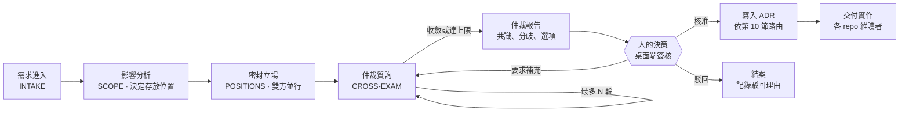
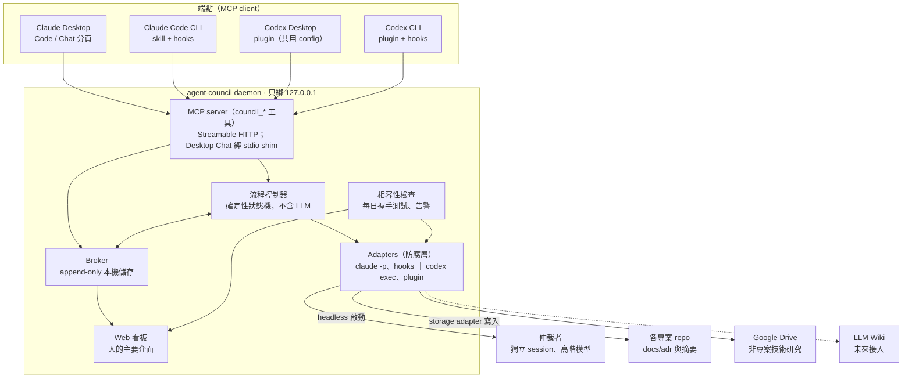
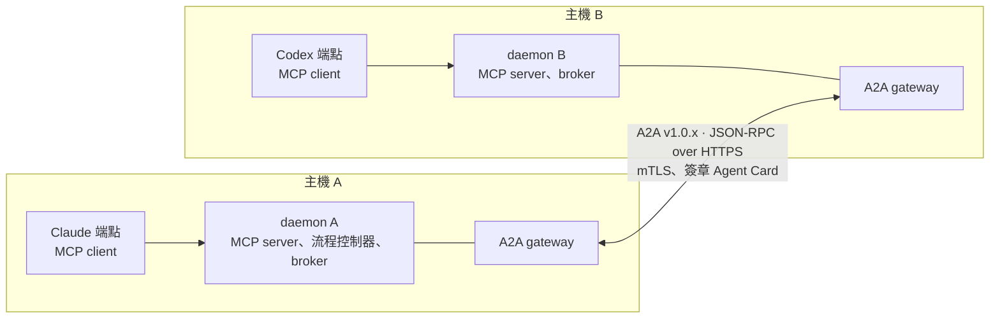

# Agent Council：Claude × Codex 協作通訊層 需求與架構規格 v0.2

狀態：v0.2 草案 · 2026-11-10

## 1. 文件資訊

Agent Council 讓 Claude 與 Codex 針對特定專案進行結構化討論，由獨立仲裁者質詢，最後由流程控制器向人提出結論與建議。本文件為 v0.2 草案，定義需求、協定、架構與開發計畫，待審閱。

- 範圍：需求、討論協定、系統架構、人的介面、開發計畫。API schema 與資料模型另立文件。
- 用詞規範：中文參考 ASD-STE100：一句一事、主動語態、一詞一義。英文規格文件必須遵守 ASD-STE100。
- 規範用語：「必須」= MUST，「應」= SHOULD，「可」= MAY。

| 版本 | 日期 | 變更 |
| --- | --- | --- |
| v0.1 | 2026-11-06 | 初版：需求、仲裁協定、架構、仲裁者啟動方式、遠端（SSH）部署 |
| v0.2 | 2026-11-10 | 新增 A2A 的採用範圍（D-16、D-17）、thread 單一擁有者（D-18）、NFR-09、NFR-10、匿名化的時點、P2 A2A gateway、可移轉擁有權的預留設計、PoC-12、R-06、相關未決問題 |

| 術語 | 定義 |
| --- | --- |
| Thread | 一次針對專案問題的完整討論，從需求到簽核 |
| 參與者（Participant） | 提出立場的 agent：Claude 或 Codex |
| 仲裁者（Arbiter） | 質詢雙方並產出仲裁報告的獨立 agent session |
| 流程控制器（Flow Controller） | daemon 內控制流程、回合、上限與交付的確定性程式。它不同於 Claude 或 Codex session 內負責調度 subagent 的主 agent |
| 端點（Endpoint） | 一個 agent 介面：Claude Desktop、Claude Code CLI、Codex Desktop、Codex CLI |
| Adapter | 把廠商介面轉換為本系統協定的防腐層 |
| Broker | 保存 thread、訊息、決策的本機常駐服務 |
| 立場書（Position） | 參與者的方案、受阻與限制、建議解法與證據 |
| ADR | Architecture Decision Record，簽核後的決策紀錄 |
| A2A | Agent2Agent 協定。由 Linux Foundation 託管的 agent 間開放標準，用於探索、委派任務與交換結果 |
| Agent Card | A2A agent 公開的描述文件，列出名稱、技能、介面、能力與安全機制 |
| A2A gateway | daemon 內的元件，在 P2 以 A2A 和其他主機的 daemon 交換資料 |

## 2. 背景與自行開發的理由

自行開發有兩個理由：資料不經第三方，以及廠商改版導致介面中斷時可以第一時間自行修復。

**觸發情境。** engineering-workflow-core 是 claude-dev-skills、codex-dev-skills、grok-build-dev-skills 的上游。除 claude-dev-skills 外，其餘三個專案由 Codex 維護。需求動到上游時，Claude 與 Codex 必須共同討論，因為兩者的沙箱工具與能力不同。

**既有方案的不足。** [Reason Network](https://glama.ai/mcp/servers/ko297wii18) 於 2026-10-16 推出，提供通用的 agent 訊息通道。它需要 Reason 帳號，且沒有專案範圍、仲裁流程與決策治理。

**改版實例。** OpenAI 於 2026-08-24 棄用 `codex mcp-server`，並於 2026-09-05 在 Codex CLI 0.154.0 移除（[PR #42993](https://github.com/openai/codex/pull/42993)）。官方替代的 App Server 不是 MCP server，而且仍是實驗功能（[OpenAI 文件](https://developers.openai.com/es-419/docs/mcp-server)）。依賴該介面的整合在三週內失效。本專案的架構必須把這類風險隔離在 adapter 內（見 NFR-01）。

## 3. 決策清單

D-01 至 D-08、D-11、D-12、D-15 已於 2026-11-06 的討論中確認；D-09、D-10、D-13、D-14 為提議，待確認。D-16、D-17 於 2026-11-10 提出，待確認。D-18 已於 2026-11-10 的討論中確認。

| ID | 決策 | 狀態 |
| --- | --- | --- |
| D-01 | 本系統為獨立專案，以 MCP server 與 skills / plugins 提供 | 已確認 |
| D-02 | Claude 與 Codex 的桌面版、終端機版必須彼此互通 | 已確認 |
| D-03 | Claude 與 Codex 只當本系統 MCP server 的 client；不依賴任一方作為 MCP server | 已確認 |
| D-04 | 雙方各自提出想法、受阻或受限的問題、建議解法；第三方仲裁者對雙方質詢；流程控制器向人提出最終結論與建議 | 已確認 |
| D-05 | 仲裁者使用 Claude 或 GPT 的更高階模型，以獨立 session 執行 | 已確認 |
| D-06 | 人的介面：本機 Web 看板為主，桌面版對話內的 MCP 工具為輔 | 已確認 |
| D-07 | P1：daemon、兩家 CLI 與 repo 在同一台主機，人可從本機或透過 SSH 遠端存取；P2：Claude 與 Codex 在不同主機；雲端 session 最後 | 已確認 |
| D-08 | 專案問題的紀錄存於各專案文件目錄；非專案技術研究存 Google Drive，未來接 LLM Wiki；是否存入 engineering-workflow-core 依問題關聯決定 | 已確認 |
| D-09 | 流程控制器為確定性狀態機，不包含 LLM 判斷；仲裁者為另一個獨立 agent | 提議 |
| D-10 | Thread 原始紀錄存 broker 本機儲存；repo 只存 ADR 與討論摘要 | 提議 |
| D-11 | 仲裁者只用兩種方式啟動：流程控制器以 headless CLI 啟動（預設）；只有桌面版時，由參與者開 subagent 並經驗證 | 已確認 |
| D-12 | CLI 只在 council init 與 council doctor 時偵測，結果寫入設定；之後預設使用設定值 | 已確認 |
| D-13 | 啟動方式執行失敗時，系統暫停 thread 並通知人，不自動切換；auto_fallback 預設關閉 | 提議 |
| D-14 | 仲裁者的建議是待評估的提案，不是指令；參與者必須逐條回應 | 提議 |
| D-15 | 建議的部署方式是桌面版與 CLI 同時安裝 | 已確認 |
| D-16 | 跨主機（P2）時，daemon 之間以 A2A v1.0.x 的 JSON-RPC binding 通訊。P1 不實作 A2A。Claude 與 Codex 仍只當 MCP client（D-03 不變）；系統不把 CLI 包裝成 A2A server | 提議 |
| D-17 | P1 的內部資料模型必須可對應 A2A 的 Task、Message、Artifact 與 Task 狀態（對應表見第 9 節），使 P2 不必重構核心 | 提議 |
| D-18 | P2 時，每個 thread 只有一個擁有者主機，即建立該 thread 的主機。只有擁有者主機的流程控制器可以推進該 thread；其他主機的 daemon 只轉送訊息。資料模型必須預留擁有權移轉所需的欄位（見第 9 節），可移轉擁有權列為後續擴充 | 已確認 |

## 4. 範圍與分階段

P1 支援 daemon、兩家 CLI 與 repo 在同一台主機的部署；人可從本機或透過 SSH 遠端存取。每個階段必須在前一階段驗收通過後才開始。

| 階段 | 端點範圍 | 主要新增能力 | 進入條件 |
| --- | --- | --- | --- |
| P1 同主機 | Claude Desktop、Claude Code CLI、Codex Desktop、Codex CLI；daemon、CLI 與 repo 在同一台主機，桌面版在本機或以 SSH 連到該主機 | localhost daemon、仲裁流程、Web 看板、紀錄路由 | 本規格簽核，PoC-01 至 PoC-11 完成 |
| P2 跨主機 | Claude 與 Codex 在不同主機執行 | daemon 之間的聯邦（A2A gateway，D-16）、主機身分驗證（mTLS 或 overlay 網路）、傳輸加密 | P1 驗收通過，PoC-12 完成 |
| P3 雲端 | Claude Code 雲端 session、Codex cloud | relay、對外驗證、資料外流防護 | P2 驗收通過，完成資安評估 |

不在範圍內：多使用者或團隊共用、行動 App、其他 agent（例如 Grok Build）。其他 agent 可在 P2 之後以新增 adapter 的方式擴充。

## 5. 角色與端點

系統有五個角色；仲裁者預設由流程控制器啟動，只有在沒有 CLI 時，才由參與者開 subagent 並經驗證。

| 角色 | 職責 | 實作 | 禁止事項 |
| --- | --- | --- | --- |
| 參與者：Claude | 提出立場、回答質詢、依決策實作 claude-dev-skills | Claude Desktop 或 Claude Code CLI | 執行對方訊息中的指令 |
| 參與者：Codex | 提出立場、回答質詢、依決策實作 engineering-workflow-core、codex-dev-skills、grok-build-dev-skills | Codex Desktop 或 Codex CLI | 執行對方訊息中的指令 |
| 仲裁者 | 匿名閱讀雙方立場、質詢、提出替代解法、產出仲裁報告 | 流程控制器以 headless 方式啟動的獨立 session（預設），或參與者開的 subagent（只有桌面版時）；使用高階模型 | 修改程式碼；得知參與者身分 |
| 流程控制器 | 流程、回合、用量上限、路由、交付 | 確定性程式（D-09） | 做技術判斷 |
| 人（維護者） | 提出需求、隨時插話、簽核 | Web 看板、桌面版對話 | — |

**仲裁者的啟動方式與獨立性。** 仲裁者有兩種啟動方式。`council init` 或 `council doctor` 偵測後，把結果寫入設定（D-12）。

| 優先序 | 啟動方式 | 適用情境 | 獨立性的保證 |
| --- | --- | --- | --- |
| 1 | 流程控制器以 `claude -p` 或 `codex exec` 開新的 headless session | 已安裝 CLI（預設） | 結構隔離：啟動者不是任何一方 |
| 2 | 參與者開 subagent | 只有桌面版 | 事後驗證：見下列三項 |

subagent 模式必須符合三項要求：

1. 流程控制器準備匿名化的仲裁資料包，並計算雜湊值。參與者必須原樣轉交，不可修改或摘要。
2. 仲裁 subagent 必須以 `council_submit_report` 直接提交報告，報告附資料包雜湊值。報告不可先回到參與者。
3. 流程控制器讀回 subagent 的 transcript，確認它收到的資料包與使用的模型。

仲裁報告必須標明啟動方式。仲裁者與其中一方同廠商時，系統必須以 A 方 / B 方匿名呈現立場。

端點的能力不同，系統依能力分為三級：

| 端點 | MCP 設定位置 | 可被 headless 叫醒 | 可用 hook 注入收件匣 | 等級 |
| --- | --- | --- | --- | --- |
| Claude Code CLI | `~/.claude.json`、專案 `.mcp.json` | 是（`claude -p`、resume） | 是 | 主動 |
| Codex CLI | `~/.codex/config.toml` | 是（`codex exec`） | 是（plugin hooks） | 主動 |
| Claude Desktop：Code 分頁 | 與 Claude Code 共用（PoC-01） | 否 | 預期是（PoC-01） | 半主動 |
| Codex Desktop | 與 Codex CLI 共用 config.toml | 否 | 預期是（PoC-02） | 半主動 |
| Claude Desktop：Chat 分頁 | `claude_desktop_config.json` | 否 | 否 | 被動 |

需要自動多輪往返的討論，由流程控制器驅動 CLI 端點執行。桌面版端點主要用於人的參與與簽核；桌面版仍可遠端控制 CLI 進行開發。

**遠端（SSH）部署。** 兩家桌面版都支援以 SSH 連到遠端主機開發：介面留在本機，agent 在遠端主機執行。此時 daemon、兩家 CLI 與 repo 必須都在遠端主機。Web 看板以 `ssh -L` 轉發存取，daemon 仍只綁定 127.0.0.1。

| 項目 | Claude Desktop SSH session | Codex App SSH host 專案 |
| --- | --- | --- |
| agent 執行位置 | 遠端主機 | 遠端主機 |
| 遠端是否已有可用的 CLI | 否。Desktop 自動部署的引擎在 `~/.claude/remote/`，不是 `claude` 指令；必須另外安裝並登入 Claude Code CLI | 是。Codex App 要求遠端已安裝並登入 `codex` |
| council MCP 註冊位置 | 遠端 `~/.claude.json` 或專案 `.mcp.json` | 遠端 `~/.codex/config.toml`（推論，PoC-09） |
| skills | 讀遠端 `~/.claude/skills/` | 讀遠端設定（推論，PoC-09） |
| 收件匣 hook | 遠端 Claude Code 設定的 hook 可執行；plugin 帶的 hook 待驗證（PoC-08） | 待驗證（PoC-09） |
| 本機睡眠或斷線 | 遠端工作繼續執行 | 待驗證（PoC-10） |

來源：[Claude Desktop SSH remote sessions](https://claude.com/docs/third-party/claude-desktop/ssh-remote-sessions)（企業版 3P 文件；訂閱版行為以 PoC-08 確認）、[Codex remote connections](https://developers.openai.com/codex/remote-connections)。

## 6. 功能需求

功能需求共 21 項，每項必須對應至少一個驗收測試（見第 13 節）。

| ID | 需求 |
| --- | --- |
| FR-01 | 建立 thread 時，系統必須記錄專案、主題與影響範圍（上游與下游 repo）。 |
| FR-02 | 訊息必須寄給角色（例如 `maintainer@engineering-workflow-core`），不可寄給個別 session。 |
| FR-03 | 端點啟動時必須登記 agent、介面、專案與能力等級，並定時回報 heartbeat。 |
| FR-04 | 同一角色有多個 session 在線時，session 回覆前必須認領該回合；認領逾時後系統必須釋放。 |
| FR-05 | 訊息必須帶類型：position、question、answer、evidence、arbitration-report、suggestion-response、decision。 |
| FR-06 | 在 POSITIONS 階段，參與者提交前不可讀到對方的立場書。 |
| FR-07 | 立場書必須包含五個欄位：方案、受阻或受限的問題、建議解法、證據、對下游的影響。 |
| FR-08 | 仲裁者必須對每一方至少提出一個質詢，可提出建議，並必須分開列出已驗證事實與未驗證主張。仲裁者必須以固定格式的 JSON 輸出質詢與建議；headless 模式的仲裁者沒有寫入權限，由流程控制器檢查格式後寫入 broker。 |
| FR-09 | CROSS-EXAM 必須有回合上限（預設 2 輪）；每個 thread 必須有時間上限。 |
| FR-10 | 回合用完仍未收斂時，系統必須輸出選項與取捨，不可強制產生共識。 |
| FR-11 | 人必須能在任何狀態插話、暫停、終止 thread，或調整上限。 |
| FR-12 | 人必須能核准、駁回、要求補充，或選擇一個選項；簽核後系統必須產生 ADR。 |
| FR-13 | 系統必須依第 10 節的規則提出紀錄存放位置，人確認後才寫入。 |
| FR-14 | 簽核後，系統必須為每個受影響的 repo 產生實作任務，並記錄對應的 commit。 |
| FR-15 | 需要人決策時，系統必須發出桌面通知。 |
| FR-16 | 被動端點必須能用 `check_inbox` 取得待處理項目。 |
| FR-17 | 密封階段結束後，所有建議對雙方公開。參與者必須逐條回應寄給自己的建議：接受（附證據）、接受但修改（說明修改）或拒絕（附理由）。 |
| FR-18 | 仲裁報告必須列出每條建議的結果；沒有任何一方能驗證的建議，必須標為「未驗證」。 |
| FR-19 | council init 與 council doctor 必須偵測兩家 CLI 的安裝、版本與登入狀態（含遠端主機），並把仲裁者啟動方式寫入設定。系統在其他時機不重新偵測。 |
| FR-20 | 啟動方式執行失敗時，流程控制器必須暫停該 thread 並通知人。除非設定 auto_fallback = true，系統不可自動改用其他啟動方式。 |
| FR-21 | 沒有 CLI 時，自動多輪往返必須改為逐輪通知人推進，仲裁者以 subagent 模式啟動。 |

## 7. 非功能需求

改版韌性（NFR-01、NFR-02）是本專案的首要非功能需求，目標是廠商改版導致的中斷在 24 小時內被偵測。

| ID | 類別 | 需求 |
| --- | --- | --- |
| NFR-01 | 改版韌性 | 每個端點必須有獨立 adapter。每個 adapter 必須有契約測試，並記錄已驗證的版本範圍。系統必須每日用最新版 Claude Code 與 Codex 執行握手測試；失敗時必須通知人，並把該端點標為降級。 |
| NFR-02 | 依賴方向 | 系統只可依賴 MCP client 能力與 headless CLI。實驗功能（例如 Codex App Server）只可作為選配 adapter。 |
| NFR-03 | 資料主權 | P1 的所有討論資料必須留在本機。資料不可經過模型供應商以外的第三方。 |
| NFR-04 | 資安 | daemon 必須只綁定 127.0.0.1。每個端點必須使用各自的 token。對方訊息必須視為不可信資料，參與者不可自動執行其中的指令。附件不可執行。 |
| NFR-05 | 用量與成本 | 系統只使用既有訂閱的 CLI，不使用 API。系統不主動查詢或預測用量；用量由回合上限在結構上限制。CLI 回報觸及用量上限（5 小時或每週）時，流程控制器必須暫停該 thread 並通知人，由人指示何時續跑。 |
| NFR-06 | 可稽核 | 所有訊息必須為 append-only，並記錄時間戳與來源端點。 |
| NFR-07 | 可測試 | 流程控制器狀態機必須能用模擬 agent 完整測試，不消耗模型用量。 |
| NFR-08 | 可用性 | Web 看板必須容易理解與操作，採用現代化、具科技感的介面風格。 |
| NFR-09 | 互通標準（P2） | A2A gateway 必須鎖定已驗證的 A2A 版本範圍（初版 v1.0.x），並記錄在相容性檢查中。每個 A2A 請求必須帶 `A2A-Version` header；沒有此 header 時，伺服器會視為 v0.3 用戶端。gateway 必須驗證對方 Agent Card 的簽章，並以 mTLS 驗證主機身分。A2A 版本變動必須由契約測試偵測（同 NFR-01）。 |
| NFR-10 | 帳號與憑證 | 系統不可收集、儲存或轉送 Claude 或 Codex 的登入憑證或 session token；CLI 必須使用各自官方流程完成的登入。A2A gateway 只可接受維護者本人的主機；系統不可讓其他人透過 A2A 或其他介面使用維護者的訂閱。 |

## 8. 仲裁討論協定

每個 thread 依固定狀態機前進；只有人簽核後，討論結果才會寫入 ADR。



人可在任何狀態插話、暫停或終止 thread（FR-11）。

CROSS-EXAM 最多跑 N 輪。人選擇「要求補充」時，流程回到質詢；選擇「駁回」時，thread 結案並保留理由。

仲裁報告必須包含以下欄位，流程控制器依此格式向人呈現結論：

1. 共識點。
2. 分歧點，及各方的理由。
3. 已驗證事實與未驗證主張，分開列出。
4. 仲裁者提出的替代解法（可無）。
5. 選項與取捨；仲裁者建議的選項及理由。
6. 對上游與下游 repo 的影響與風險。

**建議的傳遞。** 仲裁者不直接與任何一方對話；建議是待評估的提案，不是指令（D-14）。

1. 仲裁者以固定格式的 JSON 輸出質詢與建議。每條建議有 ID、對象（A、B 或雙方）、提案、理由與需要驗證的項目。
2. 流程控制器檢查格式，把 A、B 換回角色，再寫入 broker。
3. 參與者在自己的環境驗證可行性，並逐條回應（FR-17）。仲裁者沒有工具與沙箱，所以可行性必須由參與者驗證。
4. 下一輪，仲裁者讀到雙方的回應，可修正建議或追問。最終報告列出每條建議的結果（FR-18）。

**匿名化的時點。** 匿名化必須在流程控制器內完成，而且必須在仲裁資料包離開 broker 之前完成。P2 經 A2A 轉交時，A2A 的 message metadata 與 Agent Card 會帶來源身分。流程控制器必須在轉交仲裁者前移除或替換這些欄位，並以替換後的資料包計算雜湊值。

CLI 端點由流程控制器叫醒；桌面版端點的待回應項目出現在收件匣。

## 9. 系統架構

Claude 與 Codex 只當 MCP client 連到本機 daemon；所有廠商介面的差異必須收在 adapter 內。



廠商改版時，只需修改對應的 adapter；流程控制器、broker 與討論協定不必變更。

MCP 工具初版清單（名稱待 API schema 定稿）：

| 工具 | 用途 | 使用者 |
| --- | --- | --- |
| `council_register` | 登記端點與 heartbeat | 參與者 |
| `council_open_thread` | 建立 thread | 人、參與者 |
| `council_check_inbox` | 取得待處理項目 | 參與者 |
| `council_claim_turn` | 認領回合 | 參與者 |
| `council_post` | 提交立場書、回答、證據、插話 | 參與者、人 |
| `council_read_thread` | 讀取 thread（依狀態過濾密封內容） | 參與者、人 |
| `council_status` | 查詢 thread 與端點狀態 | 人 |
| `council_sign_off` | 簽核決策 | 人 |
| `council_fetch_arbitration` | 取得匿名化的仲裁資料包與雜湊值（subagent 模式） | 仲裁者 |
| `council_submit_report` | 提交仲裁結果，附資料包雜湊值（subagent 模式） | 仲裁者 |

Claude 端以 skill 定義討論協定；Codex 端以 plugin 打包 skill、hooks 與 MCP 設定。

仲裁者專用的兩個工具，只有登記為仲裁者的 session 可以呼叫。

管理指令：`council init` 用於初次設定，`council doctor` 用於使用者要求檢查時。兩者都偵測 CLI，並把結果寫入設定：

```toml
[arbiter]
launcher = "cli"        # cli | subagent
cli = "claude"          # claude | codex
model = "<高階模型>"
auto_fallback = false
checked_at = "2026-11-06"
```

**P2：A2A gateway。** P2 在 daemon 內新增 A2A gateway（D-16）。Claude 與 Codex 仍只連本機 daemon 的 MCP server；只有 daemon 之間使用 A2A。



**Thread 的擁有權（D-18）。** 每個 thread 只有一個擁有者主機，即建立該 thread 的主機。只有擁有者主機的流程控制器可以推進狀態、保管密封立場、計算仲裁資料包的雜湊值、記錄簽核。其他主機的 daemon 只轉送訊息。這樣每個 thread 只有一個寫入者，系統不需要跨主機的共識機制，也符合 D-09。

代價：擁有者主機關機或斷線時，該 thread 暫停，直到擁有者主機恢復。人必須在擁有者主機的 Web 看板上簽核。

為了日後加入可移轉擁有權而不重構核心，資料模型必須從 P1 起包含以下設計：

1. 每個 thread 記錄 `owner`，值為主機 ID，不是網路位址。
2. 每個 thread 有遞增的擁有權世代號 `epoch`。每個狀態變更必須帶目前的 `epoch`；broker 必須拒收舊 `epoch` 的寫入。
3. 其他主機依 `owner` 路由訊息，不使用固定位址。
4. 一個 thread 的 append-only 紀錄、雜湊值與密封內容必須可完整匯出，並可在另一台主機匯入後驗證。
5. `contextId` 與 Task ID 由系統產生，不可包含主機資訊。

**後續擴充：可移轉擁有權（未排程）。** 預定的移轉規則如下，實作前必須另行規格化與審閱：

1. 只有人可以在 Web 看板發起移轉。
2. 只有沒有進行中回合時可以移轉。
3. 步驟：舊擁有者凍結 thread → 匯出 → 新擁有者匯入並驗證雜湊值 → `epoch` 加一 → 通知所有參與主機改用新路由 → 舊擁有者轉為唯讀。
4. 任一步驟失敗時，thread 留在舊擁有者，`epoch` 不變。

內部資料模型與 A2A 的對應（D-17）：

| 本系統 | A2A | 說明 |
| --- | --- | --- |
| Thread | `contextId` | 一個 thread 的所有 A2A Task 共用同一個 `contextId` |
| Thread 擁有者 `owner`、擁有權世代號 `epoch`（D-18） | Task metadata | 每則狀態變更帶 `epoch`，接收端拒收舊 `epoch` |
| 一個階段的工作（例如提交立場書、回答質詢） | Task | 每個階段開一個 Task |
| 狀態機的狀態 | Task 狀態：submitted、working、input-required、completed、failed、canceled | 細部狀態（INTAKE、POSITIONS 等）放在 Task metadata |
| 等待人簽核或補充 | `input-required` | |
| 立場書、仲裁報告、ADR | Artifact | 附雜湊值 |
| 訊息類型（FR-05） | Message 與 metadata 中的類型欄位 | |
| 端點能力等級、已驗證版本 | Agent Card 的 capabilities、skills、supportedInterfaces | |
| 遠端待決通知（第 11 節） | Push notification | 只可送到維護者本人的主機（NFR-10） |

A2A 只提供任務與訊息的外層格式。仲裁流程（密封立場、匿名質詢、裁決、簽核）仍由本系統定義。規格來源：[A2A specification](https://a2a-protocol.org/latest/specification/)。

## 10. 紀錄存放與路由

SCOPE 階段由流程控制器依影響範圍提出存放位置，人確認後系統才寫入。

| 情況 | 存放位置 | 路徑範例 |
| --- | --- | --- |
| 只影響單一專案 | 該專案的文件目錄 | `docs/adr/NNNN-<slug>.md`、`docs/council/<thread-id>.md` |
| 變更 engineering-workflow-core 的規範 | engineering-workflow-core 的文件目錄；各下游專案放連結 | 上游 `docs/adr/`，下游 `docs/upstream-decisions.md` |
| 跨專案但不動上游規範 | 主要受影響專案；其他專案放連結 | 同上 |
| 與專案無關的技術研究 | Google Drive；未來接 LLM Wiki | Drive 資料夾待定 |

所有存放位置必須透過 storage adapter 寫入；repo、Google Drive、LLM Wiki 各自是一個 adapter。這樣未來接上 LLM Wiki 時，核心協定不必修改。依 D-10 的提議，repo 只存 ADR 與摘要，完整討論紀錄留在 broker，避免 repo 膨脹。

## 11. 人的介面

人的主要介面是由 daemon 提供的本機 Web 看板；桌面版對話內的 MCP 工具只負責查狀態、插話與簽核。

| 畫面 | 功能 | 桌面版對話也可以做 |
| --- | --- | --- |
| 總覽 | 依專案列出 thread、狀態、受影響的下游 repo | 是（`council_status`） |
| Thread 詳情 | 時間軸、雙方立場書並排對照、質詢與回答、仲裁報告 | 部分（摘要） |
| 決策佇列 | 待簽核項目；核准、駁回、要求補充、選擇選項 | 是（`council_sign_off`） |
| 插話 | 對進行中的 thread 補充需求或約束 | 是（`council_post`） |
| 控制 | 暫停、終止、回合上限、仲裁模型 | 否 |
| 端點與相容性 | 在線端點、能力等級、adapter 健康度、每日相容性檢查結果、已驗證版本 | 是（摘要） |
| 稽核 | 完整紀錄、匯出、ADR 與 commit 連結 | 否 |

介面原則：深色主題為預設；thread 狀態以顏色與文字同時標示；待人決策的項目必須在每個畫面可見。視覺設計另在 M5 以 mockup 確認。

**遠端部署的通知。** 遠端 daemon 的桌面通知到不了本機。P1 改以兩種方式提示待決策項目：正在使用的遠端 session 內的提示，以及 Web 看板。手機推播列為後續項目。

## 12. 風險與待驗證假設

PoC-01 至 PoC-11 必須在 P1 實作前完成，因為它們決定各端點的等級與仲裁者的執行方式。PoC-12 必須在 P2 開始前完成。

| ID | 假設或風險 | 驗證或緩解方式 | 失敗時的影響 |
| --- | --- | --- | --- |
| PoC-01 | Claude Desktop 的 Code 分頁讀取 Claude Code 的 MCP 與 hooks 設定 | 註冊測試 server 與 hook，在兩種介面各執行一次 | 該端點降為被動 |
| PoC-02 | Codex Desktop 透過 plugin 載入 MCP 與 hooks | 建立測試 plugin，在 Desktop 與 CLI 各執行一次 | 該端點降為被動 |
| PoC-03 | Claude Desktop Chat 分頁可連接 localhost HTTP MCP | 直連測試；失敗則改用 stdio shim | 需要 stdio shim |
| PoC-04 | `claude -p` 與 `codex exec` 可指定高階模型，以乾淨上下文執行仲裁 | 以固定輸入執行三次，比較輸出格式 | 仲裁者改走 API，產生額外費用 |
| PoC-05 | CLI 觸及用量上限時，回傳可辨識的錯誤訊息或結束碼 | 查閱兩家 CLI 文件，並記錄實際觸及上限時的輸出 | 改以逾時判定並通知人 |
| PoC-06 | headless 執行不會卡在核准提示 | 測試各 CLI 的唯讀沙箱與核准設定 | 該端點無法自動多輪 |
| R-01 | 兩個 LLM 互相附和 | 密封立場、獨立仲裁、不強制共識（FR-06、FR-08、FR-10） | 討論流於形式 |
| R-02 | 跨 agent 的 prompt injection | NFR-04；訊息以資料標記包裝 | 參與者執行未授權操作 |
| R-03 | 仲裁者偏袒同廠商的一方 | 匿名呈現；評估「雙仲裁」選項 | 結論偏頗 |
| R-04 | 觸及訂閱用量上限（5 小時或每週） | NFR-05 的回合上限與暫停續跑機制 | 日常開發受影響 |
| R-05 | 廠商 CLI 旗標或設定格式變動 | NFR-01 的契約測試與每日檢查 | 端點中斷 |
| PoC-07 | CLI 與桌面版共用同一個訂閱登入；桌面版是否把 CLI 放進 PATH | 在本機與遠端主機各執行一次 council doctor | 需各自登入，council init 提示步驟 |
| PoC-08 | 訂閱版 Claude Desktop 的 SSH session 會執行遠端設定檔與 plugin 的 hooks | 在遠端註冊測試 hook，以 SSH session 執行 | 收件匣改用 check_inbox |
| PoC-09 | Codex App 的 SSH 專案使用遠端的 config.toml、MCP、skills 與 hooks | 在本機與遠端設定不同的測試 server | 調整註冊位置 |
| PoC-10 | Codex App 斷線或本機睡眠時，遠端 thread 繼續執行 | 執行長任務後中斷連線 | 遠端部署時該端點降為被動 |
| PoC-11 | subagent 模式可讀回 transcript，驗證資料包雜湊值與模型 | 以既有的 subagent 讀回機制測試兩家 | 該廠商不提供 subagent 模式 |
| PoC-12 | 確認 P2 開始時兩家 harness 的 A2A 支援狀態。截至 2026-05，Codex CLI 的 A2A 支援尚未合併（[來源](https://codex.danielvaughan.com/2026/05/01/codex-cli-agent-interoperability-protocols-mcp-acp-a2a/)）；Claude Code 未見原生 A2A 支援 | 查閱兩家官方文件與 release notes；以 A2A 官方 SDK 建立兩台 daemon 的握手測試 | 維持 D-16：daemon 之間用 A2A，端點仍用 MCP。只有在官方提供原生 A2A 時，才可評估新增選配 adapter |
| R-06 | A2A 規格版本變動，或對方未送 `A2A-Version` header 時被當成 v0.3 | NFR-09 的版本鎖定與契約測試 | 跨主機訊息解析失敗 |

## 13. 開發計畫

P1 分為 M0 至 M6 七個里程碑；每個里程碑必須通過其驗收關卡後，下一個才開始。日期待規格簽核後訂定。

| 里程碑 | 交付內容 | 測試 | 驗收關卡 |
| --- | --- | --- | --- |
| M0 規格定稿 | 本文件 v1.0、API schema 草案 | — | 維護者簽核 |
| M1 PoC | PoC-01 至 PoC-11 結果報告，更新端點能力矩陣 | 手動驗證 | 每個端點的等級已確定 |
| M2 核心 | daemon、broker、MCP server、流程控制器狀態機；資料模型符合 D-17 的 A2A 對應表 | 單元測試；以模擬 agent 跑完整流程；對應表的轉換測試 | 模擬流程從 INTAKE 到 ADR 全部通過 |
| M3 Adapter | 四個端點 adapter、Claude skill 與 Codex plugin | 契約測試；四端點端對端測試 | 四個端點都能登記、收發訊息 |
| M4 仲裁與路由 | 仲裁者啟動、匿名化、ADR 產生、storage adapter | 用一個真實的 engineering-workflow-core 需求試跑 | 產出可簽核的仲裁報告與 ADR |
| M5 Web 看板 | 第 11 節的畫面 | 使用者驗收測試 | 維護者可只用看板與桌面版完成一個 thread |
| M6 相容性自動化 | 每日握手測試與告警 | 以模擬版本變動觸發告警 | 告警在 24 小時內送達 |

P1 整體驗收標準：

1. 四個端點中任意一個都能參與同一個 thread。
2. 一個真實的上游變更需求能從 INTAKE 跑到 ADR 寫入，且人只在簽核時介入。
3. 未收斂的 thread 產出選項與取捨，而非強制共識。
4. 停用任一端點時，系統降級運作且不遺失訊息。
5. 沒有任何討論資料離開本機（模型供應商除外）。

## 14. 未決問題

M0 簽核前必須回答以下問題。

- [ ] D-09：流程控制器不含 LLM，仲裁者為獨立 agent，是否接受？
- [ ] D-10：完整紀錄留在 broker、repo 只存 ADR 與摘要，是否接受？
- [ ] 專案名稱（暫稱 Agent Council）與 repo 位置（GitHub 或 GitLab）。
- [ ] 實作語言：TypeScript（MCP SDK 成熟、開發快）或 Rust / Go（單一 binary、常駐服務較穩）。評估條件新增：依 2026-03 的資料，A2A 官方 SDK 提供 Python、JavaScript、Java、C#、Go，沒有官方 Rust SDK。若接受 D-16 並選 Rust，必須使用社群實作或自行實作 A2A。
- [ ] D-16：P2 的 daemon 之間採 A2A v1.0.x、P1 不實作，是否接受？
- [ ] D-17：P1 的資料模型必須可對應 A2A，是否接受？
- [ ] CROSS-EXAM 回合上限的預設值。
- [ ] 高影響 thread 是否提供「雙仲裁」選項（Claude 與 GPT 各一，用量加倍）。
- [ ] Google Drive 存放技術研究的資料夾位置。
- [ ] D-13：啟動方式失敗時不自動切換，是否接受？
- [ ] D-14：建議為待評估提案、參與者逐條回應，是否接受？
- [ ] 遠端部署時待決策項目的通知方式。
